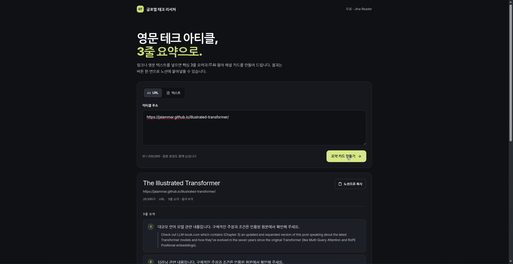

# 글로벌 테크 리서처 (Global Tech Researcher)

해외 기술 블로그·영문 아티클을 넣으면 **한국어 3줄 요약 + 핵심 IT/AI 용어 해설 카드**로 바꿔 주는 리서치 데스크입니다.
결과는 버튼 한 번으로 **노션에 바로 붙여넣을 수 있는 Markdown**으로 복사됩니다.

- 🚀 **라이브 데모**: https://3d40a360-d620-4bab-802c-832c1684a39c-00-a509i7s36p1y.pike.replit.dev/
- 💻 **저장소**: https://github.com/joonseoham18-svg/global-tech-researcher



## 무엇을 해 주나요

| 기능 | 설명 |
| --- | --- |
| URL → 본문 추출 | `https://r.jina.ai/<URL>` 로 원문 본문을 가져옵니다. 읽기 전용이라 광고·내비게이션을 걷어낸 텍스트가 들어옵니다. |
| 붙여넣은 영문도 OK | URL 없이 영문 텍스트를 그대로 넣어도 동일하게 분석합니다. |
| 3줄 요약 | 문장 중요도(위치·길이·키워드 밀도)를 점수화해 핵심 문장 3개를 고르고, 각 문장 옆에 근거가 된 **영문 원문**을 함께 남깁니다. |
| 용어 해설 | IT/AI 용어 사전(60여 개)과 본문에서 반복되는 기술 용어를 찾아 쉬운 한국어로 풀어 줍니다. |
| 키워드 | 불용어를 제거한 빈도 분석으로 아티클의 핵심 키워드를 뽑습니다. |
| 노션 원클릭 복사 | 제목·출처·요약·키워드·용어·인사이트를 Markdown으로 클립보드에 복사합니다. |

## 비용

OpenAI·Anthropic 같은 유료 AI API를 **호출하지 않습니다.**
본문 추출은 무료 Jina Reader, 요약·용어 추출은 서버 안의 규칙 기반 JavaScript로 처리하므로 API 키도 결제도 필요 없습니다.

> 요약 문장은 자연스러운 번역이 아니라 규칙 기반 요점입니다. 그래서 화면에는 항상 **근거가 된 영문 원문 문장**을 나란히 보여 줍니다.

## 구조

pnpm 워크스페이스 모노레포입니다.

```
artifacts/
  global-tech-researcher/   # React + Vite 프론트엔드
    src/App.tsx             # 화면 전체 (입력 · 결과 카드 · 노션 복사)
    src/index.css           # 다크 테마 디자인 시스템
  api-server/               # Express 5 API
    src/routes/research.ts       # POST /api/research/analyze
    src/lib/research-analysis.ts # Jina Reader 본문 추출 + 규칙 기반 분석 엔진
lib/
  api-spec/openapi.yaml     # API 계약 (Orval로 클라이언트/스키마 코드 생성)
  api-zod/                  # 요청·응답 Zod 스키마
  api-client-react/         # React Query 훅 (useAnalyzeResearch)
scripts/                    # 워크스페이스 유틸 스크립트
```

### 동작 흐름

1. 프론트엔드가 `POST /api/research/analyze` 로 `{ source }` 를 보냅니다.
2. 서버는 입력이 URL이면 `r.jina.ai`로 본문을 읽고, 아니면 입력 텍스트를 그대로 사용합니다.
3. `research-analysis.ts` 가 문장을 쪼개 중요도를 매기고, 용어 사전과 매칭해 결과를 만듭니다.
4. 프론트엔드는 요약·키워드·용어·인사이트를 카드로 그리고, Markdown 복사 버튼을 제공합니다.

## 로컬에서 실행

Node.js 24+, pnpm 10+ 가 필요합니다.

```bash
pnpm install
pnpm --filter @workspace/api-server run dev      # API 서버 (포트 5000)
pnpm --filter @workspace/global-tech-researcher run dev
```

타입 검사와 빌드:

```bash
pnpm run typecheck
pnpm run build
```

## API

```http
POST /api/research/analyze
Content-Type: application/json

{ "source": "https://example.com/some-english-article" }
```

응답은 제목, 출처, 3줄 요약(한국어 + 영문 원문), 키워드, 용어, 한 줄 인사이트를 담은 JSON입니다.
계약은 `lib/api-spec/openapi.yaml` 에 정의되어 있고, `pnpm --filter @workspace/api-spec run codegen` 으로 클라이언트와 Zod 스키마를 다시 생성할 수 있습니다.

## 참고

- Jina Reader는 외부 무료 서비스라 가용성이나 요청 제한이 달라질 수 있습니다.
- 요약 품질은 규칙 기반이라 긴 아티클일수록 원문 확인이 필요합니다.
- 이 저장소는 Replit Agent로 만든 프로젝트를 그대로 올린 것입니다.
